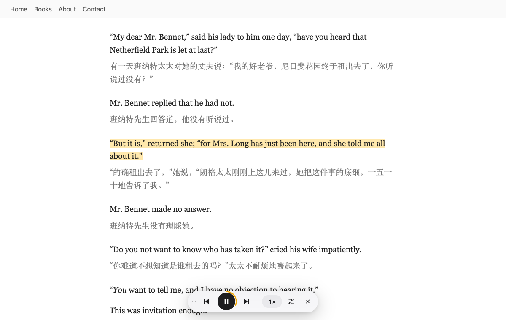
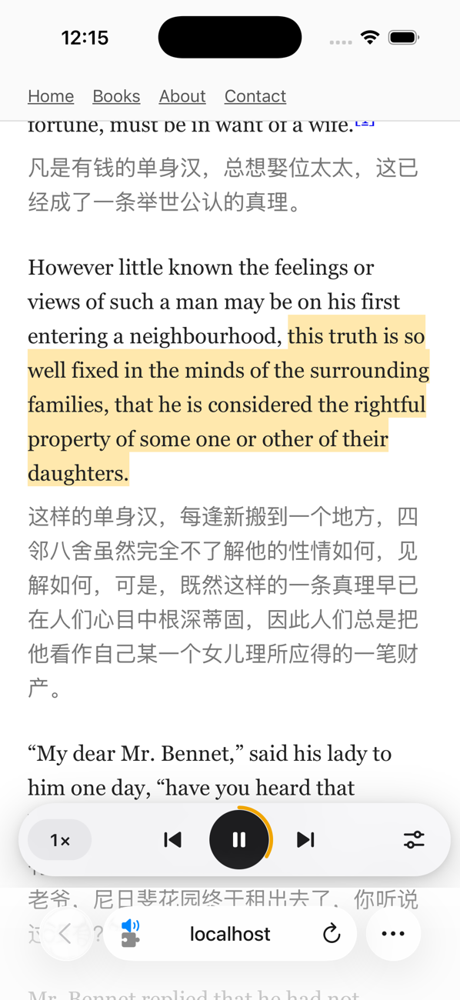
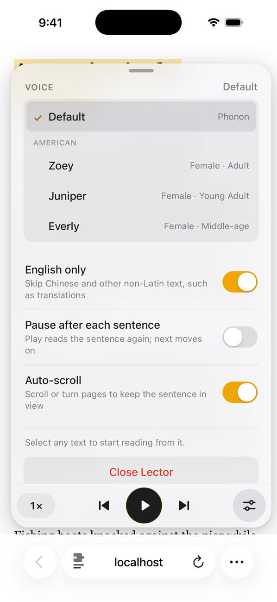

# Lector

Read any web page aloud, one sentence at a time, with a natural voice that runs entirely on your device.

Lector is a browser extension for Chrome and for Safari on iPhone and iPad. It puts a small player at the bottom of the page with **previous sentence · play/pause · next sentence**, highlights the sentence being read, and keeps it in view as it goes. The voice is [Phonon 31M](https://huggingface.co/gradium/phonon-31m-en), a neural text-to-speech model compiled to WebAssembly: no server, no API key, and nothing you read leaves your device.

<p align="center">
  
</p>

<p align="center">
  
  &nbsp;&nbsp;
  
</p>

## Features

- **Sentence by sentence.** Step back and forward a sentence at a time, or let it read on. The current sentence is highlighted on the page without changing the page's markup.
- **English only, for bilingual pages.** If you read with translations shown under the original text, Lector reads just the English and skips the Chinese, Japanese, Korean and other non-Latin lines. Turn it off to have those read by your system's voice.
- **Follows along.** It scrolls to keep the sentence in view. In paginated readers that lay text out in CSS columns, it turns the page. Scroll away and Lector stops following; one tap brings you back, or starts reading from where you are.
- **Starts where you are.** It begins at the first sentence on screen, at your text selection, or at the sentence you ⌥-click.
- **Reads the article, not the furniture.** Navigation, sidebars, infoboxes, captions, photo credits, footnote marks and code blocks are skipped. Text inside shadow DOM is read too.
- **Instant next and previous.** The sentence you're about to hear is generated first, the next few are prepared in advance, and recent ones are kept, so skipping is immediate.
- **25 English voices** (American and British), speed from 0.5× to 2.5× with pitch preserved, and an option to pause after each sentence.
- **Made for both platforms.** On a Mac: keyboard shortcuts, media keys and AirPods controls. On iPhone: large touch targets, select-to-start, and Lock Screen controls.

## Install

You build Lector from source; both builds need the voice model, which is downloaded from Hugging Face (about 70 MB).

```sh
git clone https://github.com/illusion77/lector.git
cd lector
npm install
npm run fetch-model
npm run build
```

### Chrome

1. Open `chrome://extensions` and turn on **Developer mode**.
2. Click **Load unpacked** and choose `dist/chrome`.
3. Pin Lector to the toolbar.

### iPhone and iPad (Safari)

You need a Mac with Xcode and an Apple developer account; a free account works.

1. Run `npm run build` (the Xcode project uses the files in `dist/safari`).
2. Open `safari/Lector/Lector.xcodeproj`.
3. For both targets, choose your team under **Signing & Capabilities**. Change the bundle identifiers if Xcode asks you to.
4. Run the **Lector** scheme on your device.
5. On the device, open **Settings › Apps › Safari › Extensions › Lector**, turn it on, and set **All Websites** to **Allow**.

Apps signed with a free account stop launching after seven days; build and run again to renew.

## Using Lector

### On a Mac

| | |
| --- | --- |
| Open Lector and play / pause | Toolbar button, or <kbd>⌥K</kbd> |
| Previous / next sentence | <kbd>⌥↑</kbd> / <kbd>⌥↓</kbd>, or <kbd>⌥J</kbd> / <kbd>⌥L</kbd> |
| Slower / faster | <kbd>⌥←</kbd> / <kbd>⌥→</kbd> |
| Read from a sentence | <kbd>⌥</kbd>-click it, or right-click › **Read aloud from here** |
| Media keys and AirPods | Play/pause, previous, next |

After you click a control in the player, <kbd>Space</kbd>, <kbd>↑</kbd> and <kbd>↓</kbd> work too. Drag the player by any blank spot to move it; Lector remembers where you put it on each site.

### On iPhone

- In Safari, tap the page menu in the address bar, then **Lector**.
- Tap play. iOS needs this one tap before any page can play sound.
- Select some text to get **Read from selection**.
- If you scroll away, **Back to sentence** returns to where Lector is reading and **Read from here** starts from what's on screen.
- Drag the player up or down to move it. Drag it off the bottom edge, or use **Close Lector** in settings, to close it.
- The Lock Screen and Control Center skip buttons move by sentence.

### Settings

Tap the sliders button for voice, **English only**, **Pause after each sentence**, and **Auto-scroll**. Tap the speed button for presets and a slider. On iPhone, pull either card down to put it away. Settings are shared by every site.

## How it works

```
src/
  background.ts         toolbar button and context menu
  content/              runs in the page
    text-model.ts       the page as sentences: rendered text in reading order, grouped by block
    segment.ts          sentence splitting and script detection (no DOM; unit-tested)
    controller.ts       the reading session: current sentence, what happens next
    highlight.ts        the highlight (CSS Custom Highlight API)
    follow.ts           scrolling and page turning
    bar.ts              the player frame and the chips above it
  player/               the player frame, an extension page
    player.ts           controls, settings card, audio, Media Session
    engine.ts           Phonon in a worker, with a priority queue and cache
    system-voice.ts     the browser's speech synthesis for non-English text
scripts/                fetch-model and build
safari/                 the Xcode project for the iOS app that carries the Safari extension
```

- **Text model.** The content script walks the page in rendering order, through open shadow roots and slots, and skips hidden text and page chrome. Text is grouped into runs that share a block box. Each run is split into sentences with `Intl.Segmenter`, plus fixes for titles and initials (“Mr.”, “J. K.”), passages that switch between English and CJK without punctuation, and overlong sentences. Every sentence maps back to a DOM `Range`, so it can be highlighted and scrolled to. The model is rebuilt when the page changes.
- **Player.** The player is an extension page shown in an iframe. Audio and the WebAssembly model run in the extension's origin, unaffected by the page's security policy, and a tap on the player counts as the user gesture iOS requires before it plays sound.
- **Voice.** [phonon-tts](https://www.npmjs.com/package/phonon-tts) runs the model in a Web Worker, about 5–8× faster than real time on one CPU core. Each sentence becomes a short WAV clip with its silent edges trimmed. It plays through an `<audio>` element, so speed changes keep the pitch and Media Session controls work.
- **Paginated readers.** When the next sentence sits in a clipped multi-column container, off to the side, Lector presses the arrow keys the way a reader would, until the sentence shows.

## Development

```sh
npm run watch       # rebuild on change, then reload the extension
npm test            # sentence segmentation tests
npm run typecheck
```

To read logs from an iPhone or the iOS Simulator, start a server that accepts POSTs on port 8767 (any one will do), then build with `LECTOR_DEBUG=http://<your-mac>:8767/ npm run build`. The player and the content script post their logs to it.

## Limitations

- Chrome may block sound until you've interacted with the page. If the play button pulses, click it once; <kbd>⌥K</kbd> always starts right away.
- The neural voice speaks English only. With **English only** turned off, other languages use the system voice, which varies by device.
- Text inside cross-origin iframes and canvases isn't read. Neither are closed shadow roots in Safari.
- On iPhone, reading may stop when Safari goes to the background or the screen locks.

## Credits and license

- Voice model: [Phonon 31M](https://huggingface.co/gradium/phonon-31m-en) and [Phonon voices](https://huggingface.co/gradium/phonon-voices) by Gradium, under the Apache License 2.0.
- Runtime: [phonon-tts](https://github.com/gradium-ai/xn-ptts), under MIT or Apache-2.0. Its third-party notices ship in `vendor/phonon-tts/THIRD_PARTY_LICENSES.md` in each build.
- Lector is released under the [MIT License](LICENSE).
